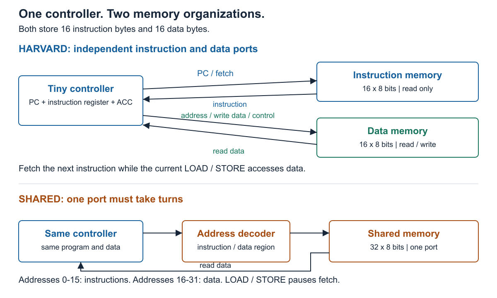
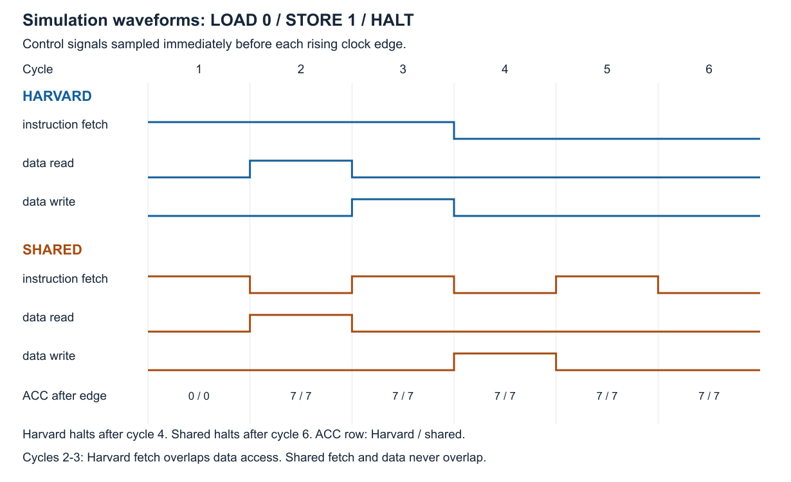

<div align="center">

# HEXARCH

### Instruction and Data Memory Hierarchy: Harvard vs von Neumann-style memory in Verilog

**Project 9 · MCA Projects 2026 · Section A · Team HEXARCH**

<a href="output/pdf/HEXARCH_Phase_I_Report.pdf"></a>
<!-- VIDEO-BADGE --><a href="VIDEO.md"></a><!-- /VIDEO-BADGE -->
<a href="https://mitul-bhatia.github.io/HEXARCH/"></a>
<a href="https://mitul-bhatia.github.io/HEXARCH/team.html"></a>

<a href="https://github.com/mitul-bhatia/HEXARCH/actions/workflows/tests.yml"></a>
<a href="https://github.com/mitul-bhatia/HEXARCH/actions/workflows/pages.yml"></a>


</div>

> **One idea:** separate instruction and data paths (**Harvard**) let an instruction fetch and a data access happen in the same clock cycle. A **von Neumann-style** shared single-port memory must take turns. We build both around the same controller and measure the difference cycle by cycle.

## 📦 Phase I submission

| | Deliverable | Where | Status |
| :---: | --- | --- | :---: |
| 📄 | **IEEE-format report**: abstract, literature review, proposed solution, individual contributions, references | [`HEXARCH_Phase_I_Report.pdf`](output/pdf/HEXARCH_Phase_I_Report.pdf) · [LaTeX source](docs/report/phase1_report.tex) | ✅ |
| 🎬 | **Prototype video** (≤ 5 min): idea, all five members, working prototype | <!-- VIDEO-ROW -->[`VIDEO.md`](VIDEO.md): link added after recording<!-- /VIDEO-ROW --> | <!-- VIDEO-STATUS -->⏳<!-- /VIDEO-STATUS --> |
| 🧩 | **Prototype files**: Verilog RTL and testbenches | [`rtl/`](rtl/) · [`tb/`](tb/) · [`programs/`](programs/) | ✅ |
| 📊 | **Artefacts**: block diagram, waveforms, simulation results | [`docs/figures/`](docs/figures/) · [`results/`](results/) | ✅ |
| 🧪 | **Verification**: 6 scenarios + 2000 random programs, run on every change | [Simulation tests](https://github.com/mitul-bhatia/HEXARCH/actions/workflows/tests.yml) | ✅ |
| 📚 | **Explanations**: illustrated study guide, brief and rubric check | [Website](https://mitul-bhatia.github.io/HEXARCH/) · [PDF](output/pdf/HEXARCH_Study_Guide.pdf) · [requirements check](docs/REQUIREMENTS.md) | ✅ |

## 🧠 The two designs

Both run the same program on the same controller with the same 32 bytes of memory and the same clock. Only the memory wiring differs: one parameter, `SHARED_BUS`, selects it.

| 🔵 Harvard (`SHARED_BUS=0`) | 🟠 Von Neumann-style shared (`SHARED_BUS=1`) |
| --- | --- |
| 16 instruction bytes + 16 data bytes | One 32-byte memory |
| Separate instruction and data ports | One port: instructions at 0-15, data at 16-31 |
| Fetch the next instruction **while** LOAD/STORE uses data | A LOAD/STORE **blocks** the fetch for one cycle |



## ⚡ Quick start

**1. Install the tools once**

| Computer | Command |
| --- | --- |
| 🍎 macOS | `brew install icarus-verilog` |
| 🐧 Ubuntu / Debian | `sudo apt-get install -y iverilog make python3` |
| 🪟 Windows | `wsl --install -d Ubuntu` in an administrator PowerShell, restart, open *Ubuntu*, then use the Ubuntu command |

**2. Run the demonstration**

```sh
make demo
```

It runs a three-instruction program on both designs and checks the result automatically:

```text
LOAD 0     Read data[0] = 7 into the accumulator
STORE 1    Write the accumulator to data[1]
HALT       Stop
```

| Result | 🔵 Harvard | 🟠 Shared |
| --- | ---: | ---: |
| Final `data[1]` | 7 | 7 |
| **Cycles to finish** | **4** | **6** |
| Cycles where fetch and data access overlap | 2 | 0 |
| Fetches blocked by a data access | 0 | 2 |

**The general rule.** A straight-line program of `N` instructions (including HALT) with `M` LOAD/STORE instructions takes **`N + 1`** cycles on Harvard and **`N + 1 + M`** on shared memory. With no data accesses (`M = 0`) both take the same time: separate paths help only when a fetch and a data access would compete. Counts include the first fetch and the HALT; reset is excluded. This is a simulation model with combinational reads and rising-edge writes, not a general speed-up claim.



## ✅ Verify

```sh
make test     # 6 self-checking scenarios
make stress   # 2000 random programs against a software model
make check    # all of the above
```

The scenarios are the demo, address boundaries, no data access, HALT only, an invalid opcode, and a mid-program reset. Every run checks all final data words, that instructions are never overwritten, that the PC holds during a blocked fetch, and that the shared port has one user per cycle. Results are written to `build/` and copied to [`results/`](results/) only when the run passes. The same checks run on GitHub for every pull request.

<details>
<summary><b>Result files</b></summary>

| File | Contents |
| --- | --- |
| [`results/demo_output.txt`](results/demo_output.txt) | Cycle table (`F/R/W` = fetch / read / write) |
| [`results/test_output.txt`](results/test_output.txt), [`results/summary.csv`](results/summary.csv) | Every scenario's result |
| [`results/stress_output.txt`](results/stress_output.txt) | Random-program result |
| [`results/demo.vcd`](results/demo.vcd), [`results/memory_compare.vcd`](results/memory_compare.vcd) | Waveforms (open in GTKWave) |
| [`results/demo_trace.csv`](results/demo_trace.csv) | Signals used to draw the waveform figure |

</details>

## 👥 Team

| Member | Responsible for | In the video |
| --- | --- | --- |
| **Akshat Chauhan** | Instruction path: program counter, instruction memory | Scene 2 |
| **Ajeesh Amreet** | Data path: data memory, read/write control | Scene 3 |
| **Vaibhav** | Shared memory, address decoder, fetch-stall rule | Scene 4 |
| **Hardik Maheshwari** | Simulation: testbenches, results, waveforms | Scenes 5-6 |
| **Mitul Bhatia** | Integration: top level, controller, build, report, repository, video | Scenes 1, 7 |

👉 Team members: open the **[Team hub](https://mitul-bhatia.github.io/HEXARCH/team.html)**, click your name, and follow your steps. The plan and checklist are in [`docs/TEAM_AND_PLAN.md`](docs/TEAM_AND_PLAN.md).

## 🗂️ What is where

| Path | Contents |
| --- | --- |
| [`rtl/`](rtl/) | The Verilog design: 8 modules ([what each one does](docs/PROJECT_GUIDE.md#what-each-module-does)) |
| [`tb/`](tb/) | Testbenches: scenarios and the random stress test |
| [`programs/`](programs/) | Demo program and starting data (hex) |
| [`results/`](results/) | Simulation output and waveforms |
| [`docs/`](docs/) | [Simple explanation](docs/PROJECT_GUIDE.md) · [requirements check](docs/REQUIREMENTS.md) · [video script](docs/VIDEO_SCRIPT.md) · [member tasks](docs/MEMBER_TASKS.md) · figures · report and study-guide sources |
| [`output/pdf/`](output/pdf/) | Report and study guide PDFs |

<details>
<summary><b>Rebuilding the figures, report, guide and website</b></summary>

`make figures` (needs `librsvg`), `make report` (needs LaTeX), `make guide` (needs Google Chrome), `make site` (Python only). The website is rebuilt and published automatically on every merge to `main`. The bundled IEEEtran class is credited in [`THIRD_PARTY.md`](THIRD_PARTY.md).

</details>

**Scope.** The optional shared lower-level memory from the brief is planned for Phase II. This is a simulation prototype; hardware clock speed and FPGA resources have not been measured. Starter code and drafts were prepared with AI assistance, as the report's acknowledgment states.

<div align="center"><sub><b>Phase I deadline:</b> 16 November 2026, 11:59 PM IST</sub></div>
