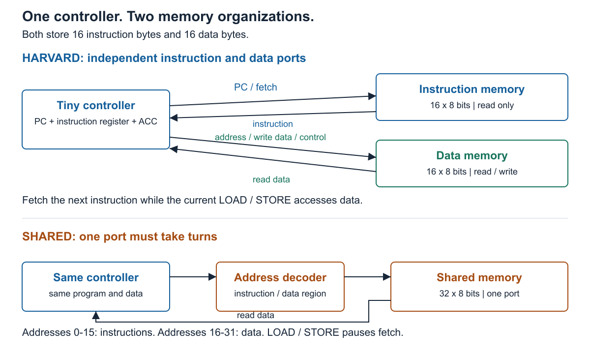
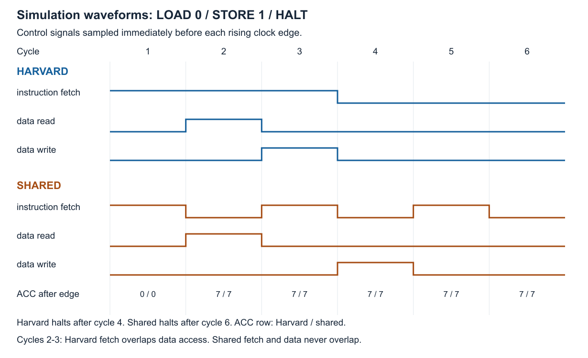

# HEXARCH | Instruction and Data Memory Hierarchy

**Project 9 - MCA Projects 2026 - Section A**

GitHub: [mitul-bhatia/HEXARCH](https://github.com/mitul-bhatia/HEXARCH) (private).

We demonstrate one idea: **separate instruction and data paths allow an instruction fetch and a data access at the same time.**

Both designs run the same small program with the same controller and total memory capacity:

| Harvard | Shared single-port memory |
| --- | --- |
| 16 instruction bytes + 16 data bytes | One 32-byte memory |
| Independent instruction and data ports | Instructions and data take turns on one port |



## Run the demonstration

Install Icarus Verilog if needed (`brew install icarus-verilog` on macOS; `sudo apt-get install iverilog make python3` on Ubuntu/Debian). Then run from this folder:

```sh
make demo
```

The program contains only three instructions:

```text
LOAD 0     Read data[0] = 7 into the accumulator
STORE 1    Write the accumulator to data[1]
HALT       Stop
```

The terminal shows six cycles and checks the result automatically:

| Result | Harvard | Shared |
| --- | ---: | ---: |
| Final data[1] | 7 | 7 |
| Completion cycles | 4 | 6 |
| Fetch/data overlap cycles | 2 | 0 |
| Fetch cycles blocked by data access | 0 | 2 |

Counts include the first fetch and HALT execution; reset is excluded. These results apply to this program and our combinational-read, rising-edge-write memory model. The same clock period is used for both designs.



## What to open

- [Simple explanation](docs/PROJECT_GUIDE.md): the six-cycle walkthrough and module guide.
- [Requirements checklist](docs/REQUIREMENTS.md): each requested deliverable and its evidence.
- [Two-page IEEE report draft](output/pdf/HEXARCH_Phase_I_Report_Draft.pdf), with editable [LaTeX source](docs/report/phase1_report.tex).
- [Video script](docs/VIDEO_SCRIPT.md): a suggested 3-minute-30-second demonstration with all five members.
- [Team details and proposed tasks](docs/TEAM_AND_PLAN.md).

The implementation is in `rtl/`; `programs/demo.hex` contains the program and `programs/data.hex` contains its starting data.

## Verify and view waveforms

```sh
make test     # All six verification scenarios
```

All six pass: the demo, address boundaries, no data accesses, HALT, invalid opcode, and reset/restart. Checks include every final data location, instruction preservation, PC hold behavior, and memory-port ownership.

- `results/demo.vcd`: short demonstration waveform; open in a VCD viewer such as GTKWave.
- `results/demo_output.txt`: readable cycle table (`F/R/W` means fetch/read/write).
- `results/demo_trace.csv`: sampled signals used to draw the waveform image.
- `results/summary.csv` and `results/test_output.txt`: full verification results.
- `results/memory_compare.vcd`: waveforms for all six scenarios.

The controller uses one instruction register to overlap fetching and execution. NOP and an invalid-opcode stop are small supporting behaviors. Supported programs fit in 16 instruction bytes and end in HALT. The optional lower-level memory is outside this project's scope. This is a simulation prototype; hardware frequency and FPGA resources have not been measured.

## Submission status

Code, diagrams, simulation evidence, and the report draft are ready for team review in the private GitHub repository linked above. The video is not recorded, and proposed contributions must be replaced with completed work. The team has confirmed Section A. Give teammates and evaluators repository access before sharing it for review or submission.

**Phase I deadline from the notice: November 16, 2026, 11:59 PM IST.**

For optional artifact regeneration, install `librsvg` and LaTeX with `pdflatex`, then run `make figures report`. Simulation needs only Icarus Verilog, Make, and Python 3. The included IEEEtran class is credited in [THIRD_PARTY.md](THIRD_PARTY.md).
